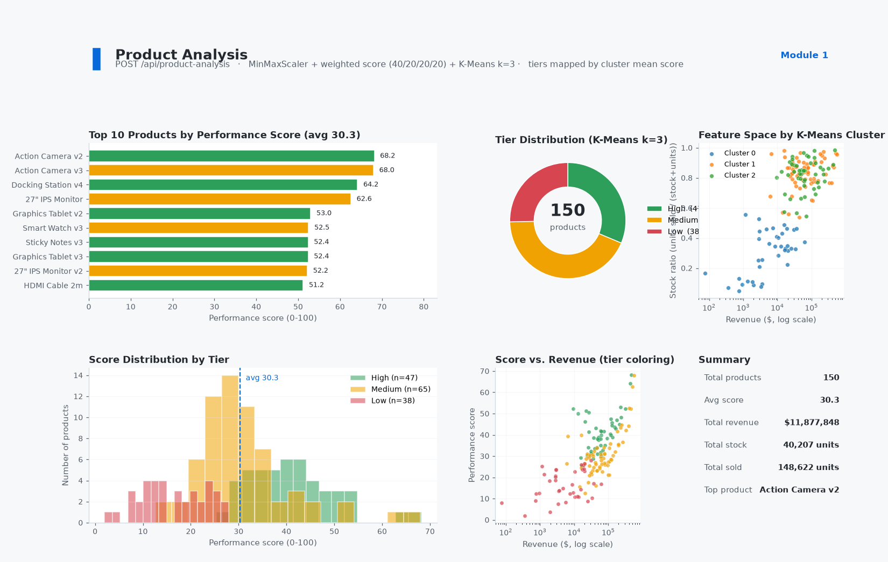
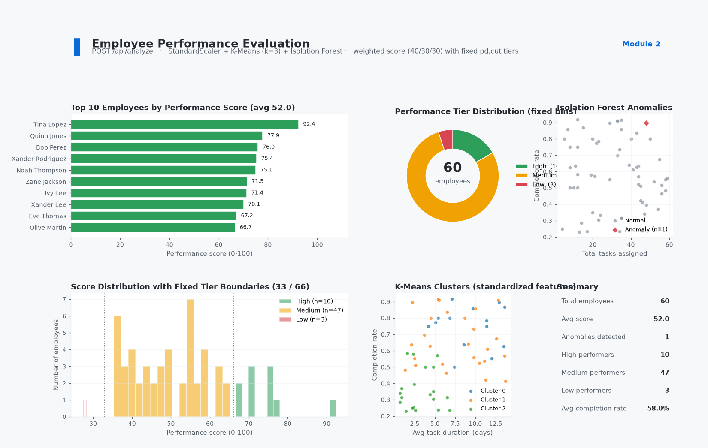
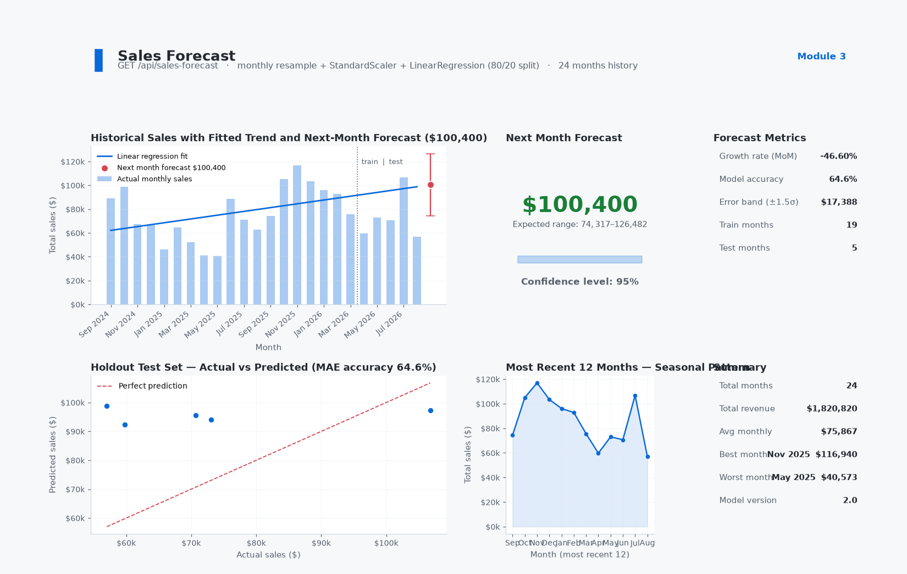
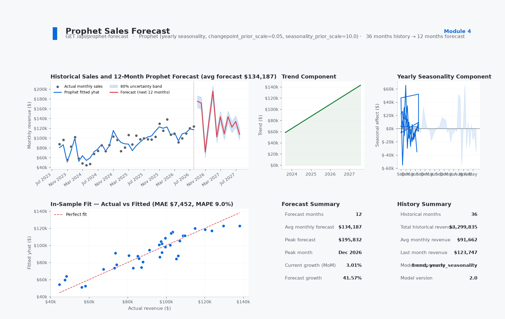
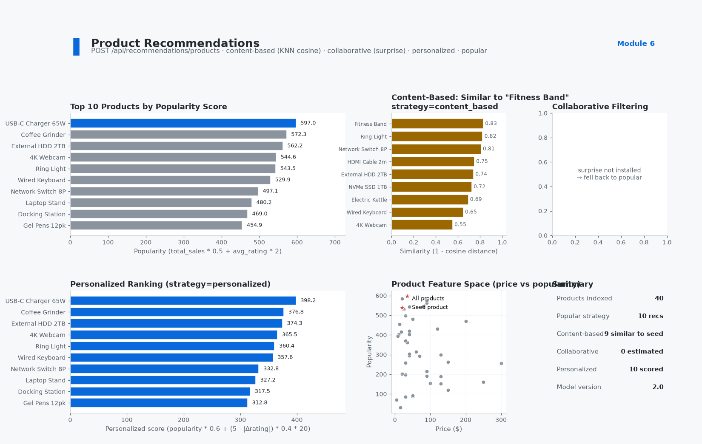
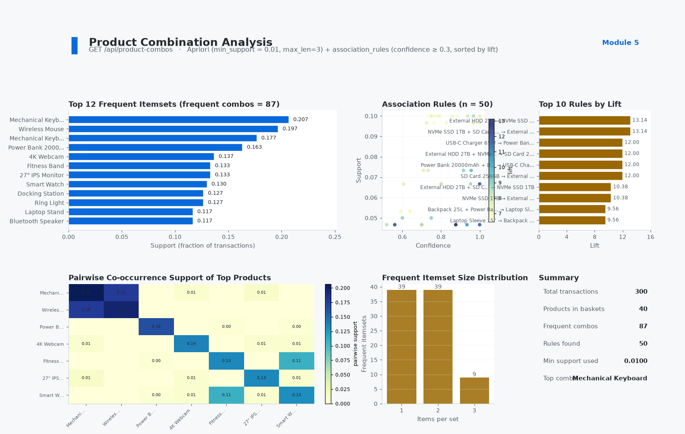

# BI System — Machine Learning Analytics for ERP

A production-grade **Business Intelligence microservice** that connects to an ERP database and exposes ML-powered analytics — product scoring, employee performance evaluation, sales forecasting, recommendation engine, and market basket analysis — through a clean REST API.

Built with **Flask + scikit-learn + Facebook Prophet** and deployed via **Docker + Nginx**.

<p align="center">
  
  
  
  
  
  
  
  
</p>

---

## ✨ Features

| Module                                 | Technique                                                 | Endpoint                             |
| -------------------------------------- | --------------------------------------------------------- | ------------------------------------ |
| 📦 **Product Performance Analysis**    | K-Means clustering + weighted scoring                     | `POST /api/product-analysis`         |
| 👥 **Employee Performance Evaluation** | K-Means + Isolation Forest anomaly detection              | `POST /api/analyze`                  |
| 📈 **Sales Forecast**                  | Linear Regression with train/test split                   | `GET /api/sales-forecast`            |
| 🔮 **Prophet Forecast**                | Facebook Prophet (seasonality + trend)                    | `GET /api/prophet-forecast`          |
| 🛒 **Product Recommendations**         | KNN content-based + collaborative filtering + trending    | `POST /api/recommendations/products` |
| 🧺 **Market Basket Analysis**          | Apriori algorithm (frequent itemsets + association rules) | `GET /api/product-combos`            |

---

## 🖼️ Dashboard Previews

Sample dashboards rendered from each endpoint (synthetic data; generators in `docs/tools/*.py`, full write-ups in `docs/models/`):

**Module 1 — Product Performance Analysis**

<p align="center"></p>

**Module 2 — Employee Performance Evaluation**

<p align="center"></p>

**Module 3 — Sales Forecast (Linear Regression)**

<p align="center"></p>

**Module 4 — Sales Forecast (Facebook Prophet)**

<p align="center"></p>

**Module 5 — Product Recommendations**

<p align="center"></p>

**Module 6 — Market Basket Analysis (Apriori)**

<p align="center"></p>

---

## 🏗️ Architecture

```
┌─────────────┐     ┌──────────────┐     ┌───────────────┐
│   Client    │────▶│  Nginx       │────▶│  Flask App    │
│ (Dashboard) │     │  (Reverse    │     │  (BI Service) │
└─────────────┘     │   Proxy)     │     └───────┬───────┘
                    └──────────────┘             │
                                          ┌──────▼───────┐
                                          │  MariaDB     │
                                          │  (ERP DB)    │
                                          └──────────────┘
```

- 🌐 **Nginx** — reverse proxy, request routing, timeout tuning
- 🧠 **Flask App** — 6 route blueprints, lazy model loading, joblib persistence
- 🗄️ **MariaDB** — shared external ERP database (not managed by this container)
- 💾 **Trained models** saved as `.joblib` files under `ml_models/`

---

## 🧰 Tech Stack

- **Backend:** 🐍 Python 3.11, ⚗️ Flask 3.0, Flask-SQLAlchemy, Flask-CORS
- **ML/DL:** 📐 scikit-learn, pandas, numpy, mlxtend (Apriori), Facebook Prophet
- **Infrastructure:** 🐳 Docker, Docker Compose, Nginx
- **Storage:** 🗄️ PyMySQL, joblib (model serialization)

---

## 🚀 Quick Start

### Prerequisites

- Docker & Docker Compose
- Access to a MariaDB/MySQL ERP database

### 1. Clone & Configure

```bash
git clone <repo-url>
cd bi-system
```

Create `flask-app/.env` from the template and point it at your database:

```bash
cp flask-app/.env.example flask-app/.env
```

```env
DB_HOST=your_mariadb_host
DB_PORT=3306
DB_NAME=laravel_db
DB_USER=bi_ro
DB_PASSWORD=your_password

# Required: every API call must send this value in the X-API-Key header.
BI_API_KEY=$(openssl rand -hex 32)
```

Use a SELECT-only MariaDB account for `DB_USER`:

```sql
CREATE USER 'bi_ro'@'%' IDENTIFIED BY 'your_password';
GRANT SELECT ON laravel_db.* TO 'bi_ro'@'%';
```

Ensure the network `erp-system_default` exists (or change `docker-compose.yml`):

```bash
docker network create erp-system_default
```

### 2. Run

```bash
docker compose up -d
```

| Service   | Address (Docker network) | Host port |
| --------- | ------------------------ | --------- |
| Flask API | `http://bi_flask:5000`   | none      |
| Nginx     | `http://bi_nginx:80`     | none      |

The containers publish **no host ports** — this is an internal service. Point the
Laravel app at `http://bi_nginx:80` on the `erp-system_default` network.

### 3. Check Health

`/health` is the only endpoint that does not require an API key:

```bash
docker compose exec bi_nginx wget -qO- http://localhost/health
# {"status":"ok","checks":{"database":"ok","model_dir":"ok"},"model_version":"2.0"}
```

For local debugging you can temporarily re-add `ports: ["5002:80"]` to `bi_nginx`.

---

## 📡 API Reference

All endpoints are available under `/api/v1` (preferred) and `/api` (temporary
legacy alias, disable with `ENABLE_LEGACY_API=0`). Every request except `/` and
`/health` requires the API key:

```bash
curl -H "X-API-Key: $BI_API_KEY" http://bi_nginx:80/api/v1/sales-forecast
```

Responses always include `X-Request-ID`; send your own to correlate logs.

### `POST /api/v1/product-analysis`

Analyzes all active products using K-Means clustering + weighted scoring (revenue, stock ratio, sales velocity, profit margin).

```json
// Response
{
  "status": "success",
  "data": [{"product_id": 1, "name": "...", "performance_score": 85.3, "performance_tier": "High", ...}],
  "summary": {"total_products": 50, "avg_score": 62.4, "high_tier": 12, ...},
  "model_version": "2.0"
}
```

### `POST /api/v1/analyze`

Evaluates employee performance based on task completion rates, task velocity, and identifies anomalies (Isolation Forest).

### `GET /api/v1/sales-forecast`

Linear regression forecast for next month's revenue. Returns historical monthly aggregated sales + prediction with confidence interval.

### `GET /api/v1/prophet-forecast`

Facebook Prophet forecast. Parameters: `?periods=12` (1–60 months). Returns historical fit, future forecast, trend decomposition, and summary metrics.

### `POST /api/v1/recommendations/products`

Multiple recommendation strategies via JSON body:

```json
{
  "strategy": "popular|trending|content_based|collaborative|personalized",
  "product_id": 123, // for content_based
  "user_id": 456, // for collaborative / personalized
  "limit": 10
}
```

### `POST /api/v1/recommendations/train`

Manually retrain the recommendation models (KNN + collaborative filtering).

### `GET /api/v1/product-combos`

Runs Apriori algorithm on completed sales transactions. Returns frequent itemsets and association rules (lift, confidence, support).

### `POST /api/v1/internal/refresh`

Recomputes the expensive payloads and writes them to the shared cache. Intended
for the ERP scheduler, not for dashboards. Optional `?targets=sales,prophet,recommendations`
(a comma-separated subset; default is all). Returns `200` with `status:
success|partial`, or `500` when every target failed. Concurrent calls return `409`.

```php
// Laravel: run nightly so dashboard requests stay fast
$schedule->call(fn () => Http::withHeaders(['X-API-Key' => config('services.bi.key')])
    ->timeout(300)
    ->post(config('services.bi.url').'/api/v1/internal/refresh'))->dailyAt('02:00');
```

### `GET /api/v1/internal/cache-status`

Reports the age in seconds of the cached forecast payloads.

---

## 📂 Project Structure

```
bi-system/
├── docker-compose.yml          # Service orchestration
├── nginx/
│   └── default.conf            # Reverse proxy config
├── flask-app/
│   ├── Dockerfile              # Python 3.11 + Prophet + dependencies
│   ├── requirements.txt
│   ├── .env                    # DB credentials (not committed)
│   ├── app.py                  # Flask app factory, auth, health, blueprint registration
│   ├── cache_utils.py          # Atomic JSON cache + .joblib writes
│   ├── models/
│   │   └── __init__.py         # All SQLAlchemy ORM models (15 tables)
│   ├── routes/
│   │   ├── __init__.py
│   │   ├── employee_performance.py    # K-Means + Isolation Forest
│   │   ├── product_analysis.py        # K-Means + weighted scoring
│   │   ├── product_recommendations.py # KNN + collaborative + trending
│   │   ├── product_combos.py          # Apriori association rules
│   │   ├── sales_forecast.py          # Linear Regression
│   │   ├── prophet_forecast.py        # Facebook Prophet
│   │   └── internal.py                # Cache refresh + cache status
│   └── ml_models/              # Trained .joblib models + cached JSON payloads
├── docs/                       # Module documentation, dashboard images, HTML export
│   ├── models/                 # In-depth per-module write-ups (Markdown)
│   ├── images/                 # Generated demo dashboard PNGs
│   ├── html/                   # HTML export of the Markdown docs
│   └── tools/                  # Demo dashboard generators + md_to_html.py
├── README.md
├── AGENTS.md                   # AI agent onboarding guide
└── case-study.md               # Comprehensive case study
```

---

## 🏷️ Model Versioning

All endpoints return `"model_version": "2.0"`. Forecast payloads (`sales-forecast`,
`prophet-forecast`) are cached for `FORECAST_CACHE_TTL` seconds (default 6 h) and
recomputed by `POST /api/v1/internal/refresh`, so dashboard requests never block
on a model fit. Product, employee, and combo analyses still compute per request;
recommendation models load lazily from `ml_models/*.joblib`. Model files and
cache payloads are written atomically so concurrent workers cannot read a
half-written file.

---

## 📜 License

MIT
